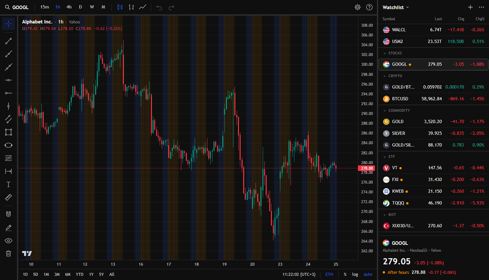

# Guraydingview

A free, local, TradingView-style charting app with **unlimited drawings**.
Stocks, ETFs, crypto, commodities, forex, Borsa Istanbul and macro data (Fed balance sheet, M2, ISM, Turkish money
supply…) on one screen — draw as many trend lines, Fibonacci levels, channels, boxes and notes as you like.



## Features

- **Unlimited drawings:** trend line, ray, extended line, horizontal / vertical line, parallel channel, rectangle,
  ellipse, Fibonacci retracement, date range, text, measure. Saved per symbol; they stay in place when you change the interval.
- **TradingView-like styling:** line color / opacity / width / style, background color and opacity, text on any
  drawing (color, size, bold / italic, alignment), lock, undo / redo, copy / paste.
- **Remembers your view:** every chart (symbol + interval) reopens exactly how you left it — zoom, scroll and a
  manually adjusted price scale.
- **Watchlist:** sections, drag & drop ordering, logos and flags, live price and change.
- **Symbol search** with categories (Stocks, Funds, Futures, Forex, Crypto, Indices, Economy): all US stocks and
  every Binance USDT pair.
- **Ratio charts:** `GOLD/SILVER`, `XU030/USDTRY`, `GOLD/BTCUSD`…
- **Pre-market / after hours** (US stocks and ETFs): intraday bars with shaded sessions, watchlist marker, price line.
- **Macro data:** FRED, ISM (PMI, New Orders, Inventories, Employment), Turkish central bank EVDS (M1, M2 and any series).
- **Year-over-year change:** **YoY %** in the bottom bar adds a band under the chart with the change against a year
  earlier, with its own % scale (like FRED's "percent change from year ago") — handy for M2, the Fed balance sheet or
  any price. Remembered per symbol.
- **Your own data:** drag & drop a CSV file onto the chart.
- **Chart style:** candle / line colors, background, grid, last price line, pre-market / after-hours colors — with opacity.
- **Bitcoin rainbow chart:** on BTC charts, colored log-regression bands behind the price, from 2010 into the future
  (**Rainbow** button in the bottom bar). The fit is recomputed daily from the whole history; a meme heuristic, not advice.
- **Claude connector:** ask Claude to read your charts and watchlist, draw support / resistance, trend lines and
  Fibonacci levels, or switch the chart you are looking at — changes show up in the open chart right away.
- **News under the chart:** ask Claude for a symbol's latest news; each item shows as a ⚡ marker under the bar of its
  date, like TradingView's news flags (hover: headline, click: summary and link). The **⚡** button in the bottom bar
  shows / hides them.
- **No console window (Windows):** an icon next to the clock with a right-click menu — open, restart, refresh data,
  log file, folder, desktop / Start menu shortcut, start with Windows, exit.

## Installation

The only requirement is **Python 3.9+** ([python.org](https://www.python.org/downloads/)). No packages to install —
standard library only.

```bash
git clone https://github.com/gkcccvvv/guraydingview.git
cd guraydingview
```

**Windows:** double-click `Guraydingview.pyw` or `Start.bat`. No console window opens; an icon appears next to the
clock and http://127.0.0.1:8765 opens in your browser. On first start a **`Guraydingview` shortcut with the app icon**
is created in the folder — use it as the launcher (or right-click the tray icon → *Create desktop shortcut* /
*Add to Start menu*). For troubleshooting, `Start (console).bat` runs the server in a console window.

**macOS / Linux:**

```bash
python3 server.py --open
```

The server only listens on `127.0.0.1`, so other computers cannot reach it. Your personal data (drawings, news,
watchlist, settings, EVDS key) lives in the `data/` folder and is never committed to git.

## Claude connector

`mcp_server.py` is an [MCP](https://modelcontextprotocol.io) server that connects Guraydingview to Claude (the Claude
desktop app or Claude Code). It uses your Claude plan; no API key is needed.

**Claude desktop app:**

```bash
python mcp_server.py --install
```

Then quit Claude completely (tray icon → Quit) and open it again. `--uninstall` removes it. The installer edits
Claude's `claude_desktop_config.json` and keeps a `.guraydingview.bak` copy next to it; you can also add the entry by
hand (Settings → Developer → Edit Config):

```json
"mcpServers": { "guraydingview": { "command": "python", "args": ["C:\\path\\to\\guraydingview\\mcp_server.py"] } }
```

**Claude Code:** `claude mcp add --scope user guraydingview -- python /path/to/guraydingview/mcp_server.py`

If Guraydingview is not running, the connector starts it. What Claude can do:

| Tool | |
|---|---|
| `get_bars` | price / data history of any symbol and interval |
| `get_quotes` | latest values, including pre-market / after hours |
| `search_symbols` | find tickers |
| `get_watchlist`, `edit_watchlist` | read the watchlist; add, move, remove symbols and sections |
| `list_drawings`, `add_drawings`, `update_drawings`, `delete_drawings` | read and draw trend lines, levels, channels, boxes, Fibonacci, date ranges, notes |
| `add_news`, `list_news`, `delete_news` | pin news to a chart (⚡ markers under the bars); Claude finds them with its web search |
| `open_chart` | switch your open chart to a symbol / interval, optionally a date range (All…) and log scale |

Try: *"Draw the main support and resistance levels on GOOGL's weekly chart"*, *"Mark the periods when USBCOI was
below 50"*, *"How did BTC do while the Fed balance sheet (WALCL) was shrinking?"*, *"Summarize today's moves in my
watchlist"*, *"Get this week's news on gold and put it on the chart"*.

News come from Claude's own web search (turn web search on in Claude); Claude writes the headlines and summaries in
its own words, in the language you chat in (translated from the source), and links the source. In the chart, a click on a marker shows its news; × removes an item.

Drawings Claude adds are marked as Claude's; open charts update right away and **Ctrl+Z** in the chart takes a change
back. Claude's comments are not investment advice.

## Symbols

Click the magnifier (top left) or just start typing on the chart.

| Type | Source |
|---|---|
| `GOOGL`, `VT`, `THYAO.IS`, `EURUSD=X`, `^GSPC` | Yahoo Finance |
| `GOLD`, `SILVER`, `USDTRY`, `XU030`, `SPX`, `DXY` | Yahoo (short names) |
| `BTCUSD`, `ETHUSDT`, `BINANCE:SOLUSDT` | Binance (`BTCUSD` / `ETHUSD` daily+ extended back to 2010 / 2015 with Yahoo and Coin Metrics) |
| `WALCL`, `USM2`, `TCU`, `M2V`, `FRED:UNRATE` | FRED |
| `USBCOI`, `USMNO`, `USISMMI`, `USISMEMP` | ISM Manufacturing (PMI, New Orders, Inventories, Employment) |
| `TRM1`, `TRM2`, `EVDS:TP.DK.USD.A.YTL` | TCMB EVDS (free API key needed) |
| `GOLD/SILVER`, `XU030/USDTRY` | Ratio of two symbols |
| Any name | `data/csv/NAME.csv`, or drag & drop a CSV |

### TCMB EVDS (TRM1, TRM2)

1. https://evds3.tcmb.gov.tr → sign in / sign up → your user name → Profile → **API Key** (free).
2. In the app: ⚙ → **TCMB EVDS** tab → paste the key → **Save and test**.
3. TRM1 / TRM2 point to TCMB's weekly "Money Supply" table (thousand TL × 1000).
   For any other series, type `EVDS:SERIES.CODE` in symbol search.

### ISM data

Since 2013 from [sofiaverma06/ism-feed](https://github.com/sofiaverma06/ism-feed) (updated automatically from ISM's
monthly release). Values are placed on their release month, like TradingView.

**1959–2012 history (optional):** download "Historical Vintages of FRED-MD 2015-01 to 2025-12 (.zip)" from the
[FRED-MD page](https://www.stlouisfed.org/research/economists/mccracken/fred-databases) with your browser. The app
finds it in the project folder or in Downloads, extracts the ISM series from the 2016-05 vintage and merges them
with the data since 2013.

### Your own data (CSV)

Drop a CSV file onto the chart (or watchlist ⋯ → *Import CSV…*); you'll be asked for a symbol name.
Rows: `date,value` or `date,open,high,low,close`, separated by `,` or `;`. Dates: `2026-11-01`, `01.11.2026`,
`2026-11` or a unix timestamp. CSV files exported from TradingView are read directly.

## Tips

- **Double-click** a drawing (or the ⚙ on its toolbar): **Style** and **Text** tabs.
- **Shift + drag:** quick measure · **Alt+T/H/V/F/C/R/E:** trend / horizontal / vertical / Fibonacci / channel / rectangle / ellipse
- **Del:** delete · **Ctrl+Z / Ctrl+Y:** undo / redo · **Ctrl+C / Ctrl+V:** copy / paste (also onto another symbol)
- **↑ / ↓:** previous / next symbol in the watchlist · all shortcuts: **?** (top right)
- **Mouse wheel over the price axis:** zoom the prices (around the price under the mouse); **auto** fits them again.
- Bottom bar: **ETH** (pre-market / after hours), **%**, **log**, **auto** scale.
- ⚙ → **Chart style:** line / candle colors, background, grid, last price line, pre-market / after-hours colors.
- Open a chart directly: `http://127.0.0.1:8765/?symbol=GOOGL&interval=1h` — add `&range=All&scale=log` for the
  whole history on a log scale (`range`: 1D … 5Y, All · `scale`: linear, log, percent), `&yoy=1` (or `0`) to switch
  the YoY band on (off) for that symbol

## Data sources and notes

- Prices: public **Yahoo Finance** and **Binance** endpoints; macro: **FRED**, **TCMB EVDS**, ism-feed.
  Early BTC / ETH prices (before Yahoo's data starts): [Coin Metrics community data](https://github.com/coinmetrics/data)
  (daily close; free for non-commercial use).
  The Yahoo endpoints are not official or documented and may change.
- Symbol lists: [rreichel3/US-Stock-Symbols](https://github.com/rreichel3/US-Stock-Symbols) and Binance `exchangeInfo`.
  Logos are fetched on first use from financialmodelingprep / parqet / spothq cryptocurrency-icons / CoinCap /
  circle-flags and cached locally; logos belong to their owners.
- Data may be delayed and is for **personal use**; ISM data belongs to the Institute for Supply Management.
- This project is **not investment advice** and is not affiliated with TradingView.

## Third-party software

Charts are drawn with [TradingView Lightweight Charts™](https://github.com/tradingview/lightweight-charts)
(Copyright © TradingView, Inc., Apache License 2.0 — see `static/lib/LICENSE-lightweight-charts.txt`).

## License

MIT — see [LICENSE](LICENSE).
