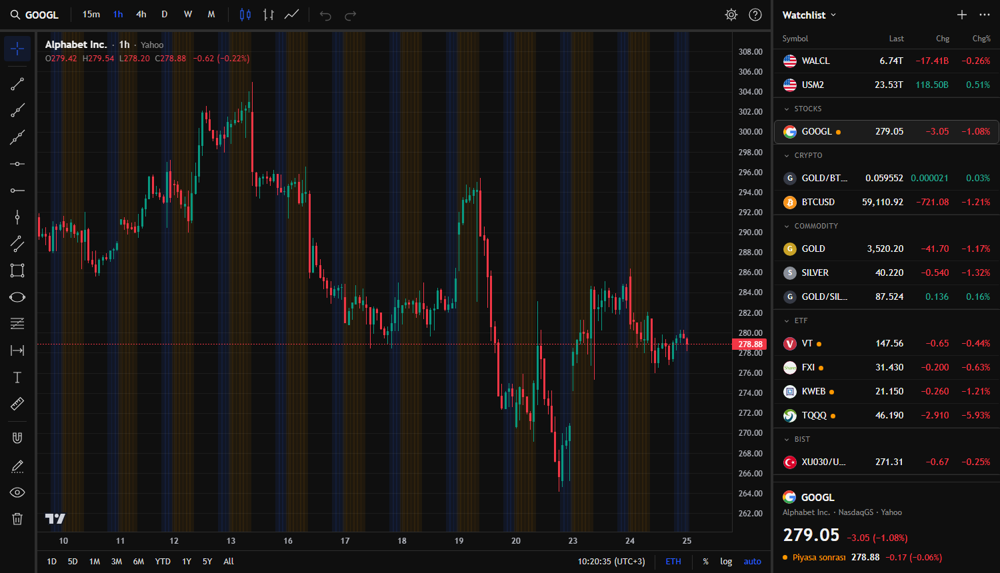

# Guraydingview — Grafik Masası

TradingView benzeri, **çizim sınırı olmayan**, kendi bilgisayarında çalışan ücretsiz grafik uygulaması.
Hisse, ETF, kripto, emtia, döviz, BIST ve makro veriler (Fed bilançosu, M2, ISM, TCMB para arzı…) tek ekranda;
istediğin kadar trend çizgisi, Fibonacci, kanal, kutu, yazı…



## Özellikler

- **Sınırsız çizim:** trend, ışın, uzatılmış çizgi, yatay/dikey çizgi, paralel kanal, dikdörtgen, elips, Fibonacci,
  kalıcı tarih aralığı, metin, ölçüm. Çizimler her sembol için ayrı kaydedilir, periyot değişince yerinde kalır.
- **TradingView gibi stil:** çizgi rengi/opaklığı/kalınlığı/stili, arka plan rengi ve sertliği, her çizime metin
  (renk, boyut, kalın/italik, hizalama), kilitleme, geri al/yinele, kopyala/yapıştır.
- **Watchlist:** bölümler, sürükle-bırak sıralama, logolar ve bayraklar, canlı fiyat/değişim.
- **Sembol arama:** kategorili (Hisse, Fon, Vadeli, Forex, Kripto, Endeks, Ekonomi); tüm ABD hisseleri ve Binance USDT çiftleri.
- **Oran grafikleri:** `GOLD/SILVER`, `XU030/USDTRY`, `GOLD/BTCUSD` gibi.
- **Piyasa öncesi / sonrası** (ABD hisse ve ETF): gün içi mumlar, renkli seans arka planı, watchlist işareti, fiyat çizgisi.
- **Makro veriler:** FRED, ISM (PMI, Yeni Siparişler, Stoklar, İstihdam), TCMB EVDS (M1, M2 ve diğer seriler).
- **Kendi verin:** CSV dosyasını grafiğe sürükle-bırak.
- **Grafik stili:** mum/çizgi renkleri, arka plan, ızgara, son fiyat çizgisi — renklerde opaklık ayarı.
- **Konsolsuz çalışma (Windows):** saatin yanında simge; sağ tık menüsünde aç, yeniden başlat, verileri yenile,
  kayıt dosyası, Windows açılınca başlat, çıkış.

## Kurulum

Gereken tek şey **Python 3.9+** ([python.org](https://www.python.org/downloads/)). Ek paket yok, sadece standart kütüphane.

```bash
git clone https://github.com/gkcccvvv/guraydingview.git
cd guraydingview
```

**Windows:** `Grafik Masasi.pyw` (ya da `Baslat.bat`) dosyasına çift tıkla. Konsol açılmaz; saatin yanına simge gelir
ve tarayıcıda http://127.0.0.1:8765 açılır. Sorun giderirken konsollu açmak için `Baslat (konsol).bat`.

**macOS / Linux:**

```bash
python3 server.py --open
```

Sunucu yalnızca `127.0.0.1` üzerinde dinler; başka bilgisayarlardan erişilemez. Kişisel verilerin (çizimler,
watchlist, ayarlar, EVDS anahtarı) `data/` klasöründe durur ve git'e eklenmez.

## Semboller

Sol üstteki büyüteç ya da grafikteyken bir harf yazmak sembol aramayı açar.

| Yazdığın | Kaynak |
|---|---|
| `GOOGL`, `VT`, `THYAO.IS`, `EURUSD=X`, `^GSPC` | Yahoo Finance |
| `GOLD`, `SILVER`, `USDTRY`, `XU030`, `SPX`, `DXY` | Yahoo (kısa adlar) |
| `BTCUSD`, `ETHUSDT`, `BINANCE:SOLUSDT` | Binance |
| `WALCL`, `USM2`, `TCU`, `M2V`, `FRED:UNRATE` | FRED |
| `USBCOI`, `USMNO`, `USISMMI`, `USISMEMP` | ISM İmalat (PMI, Yeni Siparişler, Stoklar, İstihdam) |
| `TRM1`, `TRM2`, `EVDS:TP.DK.USD.A.YTL` | TCMB EVDS (ücretsiz API anahtarı gerekir) |
| `GOLD/SILVER`, `XU030/USDTRY` | İki sembolün oranı |
| Herhangi bir ad | `data/csv/AD.csv` ya da grafiğe sürükle-bırak CSV |

### TCMB EVDS (TRM1, TRM2)

1. https://evds3.tcmb.gov.tr → giriş yap / üye ol → kullanıcı adın → Profil → **API Anahtarı** (ücretsiz).
2. Uygulamada ⚙ → **TCMB EVDS** sekmesi → anahtarı yapıştır → **Kaydet ve test et**.
3. TRM1/TRM2 varsayılan olarak TCMB'nin haftalık "Para Arzı" tablosuna bağlı (bin TL × 1000).
   Başka bir seri için sembol aramaya `EVDS:SERİ.KODU` yaz.

### ISM verileri

2013'ten itibaren [sofiaverma06/ism-feed](https://github.com/sofiaverma06/ism-feed) dosyasından gelir
(ISM'in aylık basın bülteninden otomatik güncellenir). Değerler TradingView gibi açıklandığı aya konur.

**1959–2012 geçmişi (isteğe bağlı):** [FRED-MD sayfasından](https://www.stlouisfed.org/research/economists/mccracken/fred-databases)
"Historical Vintages of FRED-MD 2015-01 to 2025-12 (.zip)" dosyasını tarayıcınla indir. Uygulama onu proje klasöründe
ya da İndirilenler'de bulur, 2016-05 sürümündeki ISM serilerini çıkarıp 2013 sonrasıyla birleştirir.

### Kendi verin (CSV)

CSV'yi grafiğin üzerine sürükle-bırak (ya da watchlist ⋯ → CSV içe aktar); sembol adını sorar.
Satırlar `tarih,değer` ya da `tarih,açılış,yüksek,düşük,kapanış`; ayraç `,` veya `;`.
Tarih biçimleri: `2026-11-01`, `01.11.2026`, `2026-11`, unix zaman damgası. TradingView'in dışa aktardığı CSV doğrudan okunur.

## Kullanım ipuçları

- Çizime **çift tıkla** ya da üstteki ⚙: **Stil** ve **Metin** sekmeleri.
- **Shift + sürükle:** hızlı ölçüm · **Alt+T/H/V/F/C/R/E:** trend / yatay / dikey / Fibonacci / kanal / dikdörtgen / elips
- **Del:** sil · **Ctrl+Z / Ctrl+Y:** geri al / yinele · **Ctrl+C / Ctrl+V:** kopyala / yapıştır (başka sembole de)
- **↑ / ↓:** watchlist'te önceki / sonraki sembol · Tüm kısayollar: sağ üstteki **?**
- Alt çubuk: **ETH** (piyasa öncesi/sonrası), **%**, **log**, **auto** ölçek.
- ⚙ → **Grafik stili:** çizgi/mum renkleri, arka plan, ızgara, son fiyat çizgisi, piyasa öncesi/sonrası renkleri.
- Adres çubuğundan doğrudan açma: `http://127.0.0.1:8765/?symbol=GOOGL&interval=1h`

## Veri kaynakları ve uyarılar

- Fiyatlar: **Yahoo Finance** ve **Binance** herkese açık uç noktaları; makro: **FRED**, **TCMB EVDS**, ism-feed.
  Yahoo uç noktaları resmi/belgelenmiş değildir; değişirse güncelleme gerekebilir.
- Sembol listeleri: [rreichel3/US-Stock-Symbols](https://github.com/rreichel3/US-Stock-Symbols) ve Binance `exchangeInfo`.
  Logolar ilk görüldüğünde financialmodelingprep / parqet / spothq cryptocurrency-icons / CoinCap / circle-flags'ten
  çekilip yerelde önbelleklenir; logolar sahiplerine aittir.
- Veriler gecikmeli olabilir ve **kişisel kullanım** içindir; ISM verileri Institute for Supply Management'a aittir.
- Bu proje **yatırım tavsiyesi değildir** ve TradingView ile bağlantılı değildir.

## Üçüncü taraf yazılım

Grafikler [TradingView Lightweight Charts™](https://github.com/tradingview/lightweight-charts) ile çizilir
(Copyright © TradingView, Inc., Apache License 2.0 — bkz. `static/lib/LICENSE-lightweight-charts.txt`).

## Lisans

MIT — bkz. [LICENSE](LICENSE).

---

### English

**Guraydingview** is a free, local, TradingView-style charting app with **unlimited drawings** (trend lines, rays,
channels, rectangles, ellipses, Fibonacci, date ranges, text…), a watchlist with logos, category symbol search
(all US stocks + Binance USDT pairs), ratio charts, pre/post-market data, and macro series (FRED, ISM, Turkish
central bank EVDS). Pure Python standard library + a static web UI; runs on `127.0.0.1`.
Run `Grafik Masasi.pyw` on Windows (tray icon) or `python3 server.py --open` anywhere. UI language: Turkish.
Not investment advice; not affiliated with TradingView.
